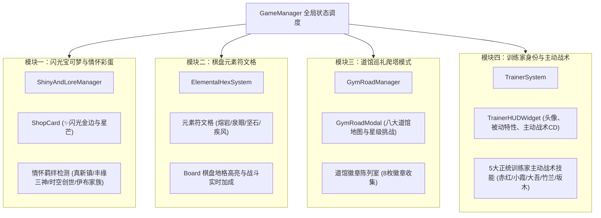

# 宝可梦自走棋四大核心拓展系统实施计划 (Multi-Agent Roadmap)

本文档规划了宝可梦自走棋 2D 经典正统体验的四大终极扩展模块。严格遵循 `BRANCH_STYLES.md` 规范（2D 像素复古与矢量插画风格，零 3D 节点）。

---

## 模块架构总览

---

## 四大模块具体设计

### 模块一：✨ 闪光异色宝可梦与情怀隐藏羁绊
1. **闪光异色宝可梦 (Shiny Variant)**：
   - 商店刷卡 1.5% 几率（沙盒可强制开启）刷出闪光宝可梦。
   - 卡牌金边流光、✨ 闪光星标徽章、登场星芒音效与金色粒子。
   - 闪光宝可梦自带 1 项随机闪光专属词缀：
     - `fortune` (招财)：普攻 10% 几率掉落 1 金币。
     - `aura` (领袖光环)：周围 1 格友军攻速 +12%。
     - `iron_will` (坚韧之躯)：控制时间减免 35%，双抗 +15。
2. **经典情怀隐藏羁绊 (Lore Synergies)**：
   - 【真新镇起航】(Pallet Town Trio)：喷火龙 + 水箭龟 + 妙蛙花。
   - 【丰缘三神】(Weather Trio)：固拉多 + 盖欧卡 + 烈空坐。
   - 【时空创世】(Creation Trio)：帝牙卢卡 + 帕路奇亚 + 骑拉帝纳 / 阿尔宙斯。
   - 【伊布全家福】(Eeveelution Family)：上阵 ≥3 种不同伊布进化形态。
   - HUD 实时播报触发横幅，并为队伍附加专属情怀共鸣增益。

---

### 模块二：🗺️ 棋盘元素符文地块系统 (Elemental Hex Nodes)
1. **随机地块生成**：
   - 每小局开局在棋盘己方半场（4×4）随机生成 2~3 个元素符文地块。
2. **四种正统元素地格**：
   - 🔥 **炽热地核 (Fire Hex)**：驻守单位攻击附带 25% 真实伤害灼烧。
   - 💧 **宁静泉眼 (Water Hex)**：驻守单位每秒额外回复 6 点法力值。
   - ⛰️ **坚毅磐石 (Rock Hex)**：驻守单位开局获得 30% 最大生命护盾，免疫击退。
   - 🌀 **疾风跃迁 (Wind Hex)**：驻守单位攻速 +35%，拥有 15% 物理闪避。
3. **视觉表现**：2D 属性粒子微光、地表镂空图腾与高对比度高亮框。

---

### 模块三：🏛️ 八大道馆巡礼爬塔模式 (Gym Battle Road)
1. **模式选择入口**：主菜单 / GameManager 新增“🏛️ 道馆巡礼”模式。
2. **八大道馆挑战关卡**：
   - 第 1 关：深灰道馆·小刚（岩石坚阵）
   - 第 2 关：华蓝道馆·小霞（激流水军）
   - 第 3 关：枯叶道馆·马志士（雷电狂暴）
   - 第 4 关：彩虹道馆·莉佳（草木领域）
   - 第 5 关：浅红道馆·阿桔（剧毒与潜行）
   - 第 6 关：金黄道馆·娜姿（超能意念）
   - 第 7 关：红莲道馆·夏伯（烈火灼烧）
   - 第 8 关：神奥联盟·竹兰（冠军级龙地对决）
3. **专属界面与徽章室**：
   - 包含关卡选择地图、三星通关评价、徽章陈列室 (`BadgeCase`)。

---

### 模块四：🧢 训练家身份与主动战术技能 (Trainer Tactics)
1. **5 大经典训练家**：
   - 🔴 **赤红 (Red)**：被动【真新意志】(低血量友军攻击 +20%)；主动【全员鼓舞】(全队攻速 +30% 持续 5s)。
   - 🔵 **小霞 (Misty)**：被动【水流环】(治疗护盾效果 +25%)；主动【生命之涌】(为最低血量 2 只友军回复 350 生命并驱散负面)。
   - ⚪ **大吾 (Steven)**：被动【钢铁之躯】(全队双抗 +25)；主动【流星落】(轰击敌方最高战力 450 伤害并眩晕 1.5s)。
   - 🟡 **竹兰 (Cynthia)**：被动【神奥羁绊】(全队暴击率 +15%)；主动【波导共鸣】(全员立即充能 30 点法力)。
   - 🟣 **坂木 (Giovanni)**：被动【火箭队底蕴】(利息上限 +1)；主动【战术征用】(立即预支 4 枚应急金币)。
2. **HUD 交互微部件**：
   - 左下角/右上角训练家头像、冷却倒计时条、一键施法按钮与 `[Q]` 快捷键。

---

## 阶段实施步骤

- **阶段一 (并行 Subagent A & B)**：
  - Subagent A：闪光宝可梦与经典情怀羁绊系统 + 自动化测试
  - Subagent B：棋盘元素符文地块系统 + 自动化测试
- **阶段二 (并行 Subagent C & D)**：
  - Subagent C：八大道馆巡礼爬塔模式与徽章陈列室 + 自动化测试
  - Subagent D：训练家身份选择与主动支援战术技能 + 自动化测试
- **阶段三 (全局整合与全量测试)**：
  - 主流程与全套自动化测试回归验证，更新文档与提交 Git。
