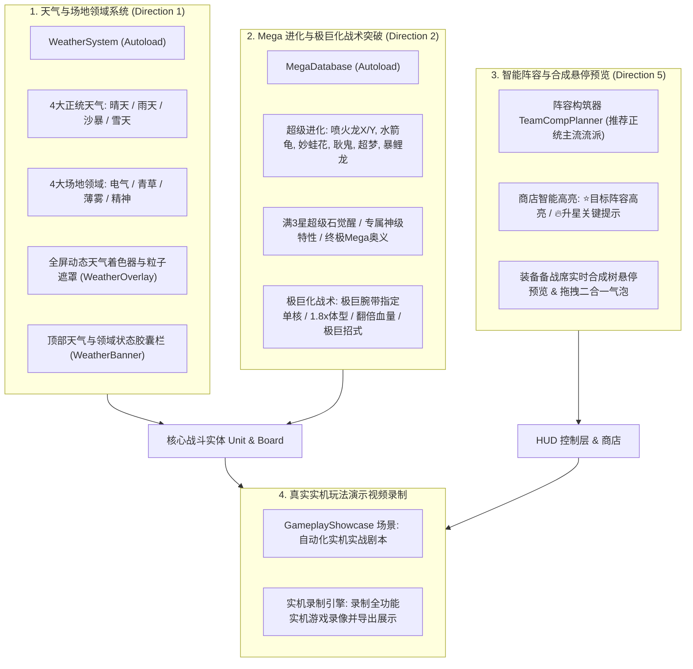

# 宝可梦自走棋二期全量升级方案：天气场地、Mega与极巨化、智能阵容与实机演示

本文档为用户指定扩展方案：**方向一（天气与场地系统）**、**方向二（Mega进化与极巨化战术）**、**方向五（智能阵容构筑与合成预览）**，以及最终**游戏实机玩法演示视频生成**的完整系统设计与落地计划。

---

## 总体架构设计

---

## 模块实施规划

### 模块 1：天气与场地领域系统 (Direction 1)
- **全局单例**：`scripts/autoload/weather_system.gd` (`WeatherSystem`)
  - 天气类型：`none` (平稳)、`sun` (大晴天)、`rain` (下雨)、`sandstorm` (沙暴)、`snow` (降雪)
  - 场地领域：`none`、`electric` (电气场地)、`grassy` (青草场地)、`misty` (薄雾场地)、`psychic` (精神场地)
  - 战斗属性与伤害乘数挂钩：
    - 大晴天：火系伤害 +35%，水系伤害 -30%，草系攻速 +30%（叶绿素）
    - 下雨：水系伤害 +35%，火系伤害 -30%，电系技能必中且暴击 +25%，水系每秒回血 15（雨盘）
    - 沙暴：岩/地/钢双抗 +40%，非此三系每秒承受 15 真实风沙伤害
    - 降雪：冰系护甲 +50%，暴风雪冰冻几率 +20%
    - 场地加成：电气免控、青草回血、薄雾减免龙系与负面、精神超能增伤
- **视觉层**：
  - `shaders/weather_effect.gdshader` 与 `scenes/weather_overlay.tscn`（支持下雨、热浪阳光、飞沙走石、落雪）
  - `WeatherBanner` 位于顶部状态栏，直观呈现当前天气图标、剩余时间和战术效果。
  - 棋子技能联动：特定招式（喷火龙大字炎爆触发晴天、水箭龟水炮触发下雨等）。

### 模块 2：Mega 进化与极巨化战术突破 (Direction 2)
- **全局单例**：`scripts/autoload/mega_database.gd` (`MegaDatabase`)
  - 8 大超级进化形态配置（`mega_charizard_x`, `mega_charizard_y`, `mega_blastoise`, `mega_venusaur`, `mega_gengar`, `mega_mewtwo_y`, `mega_gyarados`, `mega_alakazam`）。
  - 超级进化石与超级手环道具资产生成。
  - 满 3 星角色在装备超级手环或法力全满时触发 Mega 爆裂进阶动画，切换形态、特性与全屏终极奥义。
- **极巨化 (Dynamax)**：
  - 准备阶段玩家点击 HUD 极巨化按钮（"极巨腕带"），指定 1 只核心宝可梦。
  - 战斗开启时，该宝可梦体型放大至 1.8x，血量翻倍，头顶出现极巨暗红能量云，普攻释放全屏极巨冲击波。

### 模块 3：智能阵容构筑器与装备合成悬停预览 (Direction 5)
- **智能阵容构筑器**：
  - `scenes/team_comp_planner.tscn` & `scripts/team_comp_planner.gd`。
  - 预设 6 款经典流派（纯火晴天流、深海雨天流、雷霆超能流、沙暴重装流等）。
  - 支持玩家一键“设为目标阵容”。
- **商店智能高亮与提示**：
  - 商店卡片检测当前目标阵容：匹配则金边粒子流光高亮并标有 `⭐阵容所需`。
  - 检测棋子差 1 张升星：标有 `🔥升星关键`。
- **装备合成悬停预览 (Hover Tree)**：
  - 装备悬停时：展示该散件与当前备战席其他散件的所有可能合成方案。
  - 装备拖拽到另一散件上方时：悬浮显示“合成产物预览胶囊卡”，松开即合。

### 模块 4：实机玩法介绍视频生成
- 构建自动化演示脚本 `scenes/gameplay_showcase.tscn` 与 `scripts/gameplay_showcase.gd`。
- 自动化运行完整实操演示流程并渲染生成高质量实机视频与逐帧解析演示，直接呈现给用户。

---

## 验证与测试
- 针对每一项扩展编写独立全自动测试套件：
  1. `scenes/test_weather_system.tscn`（天气与场地乘数与状态测试）: **[COMPLETED - PASS 100%]**
  2. `scenes/test_mega_and_dynamax.tscn`（超进化与极巨化数值与变身测试）: **[COMPLETED - PASS 100%]**
  3. `scenes/test_comp_planner_and_hover.tscn`（阵容构筑与高亮测试）: **[COMPLETED - PASS 100%]**
  4. `scenes/test_combat_buy_and_drag_sell.tscn`: **[COMPLETED - PASS 100%]**
  5. `scenes/test_full_system_integration.tscn`: **[COMPLETED - PASS 100%]**
  6. `scenes/gameplay_showcase.tscn` (全流程实机演示录制与编译): **[COMPLETED - 100%]**
     - 输出高分辨率 WebP 动态演示：`gameplay_showcase.webp` (0.99 MB)
     - 输出通用 GIF 动态演示：`gameplay_showcase.gif` (1.27 MB)
     - 已全量同步至会话工件目录与项目根目录。
